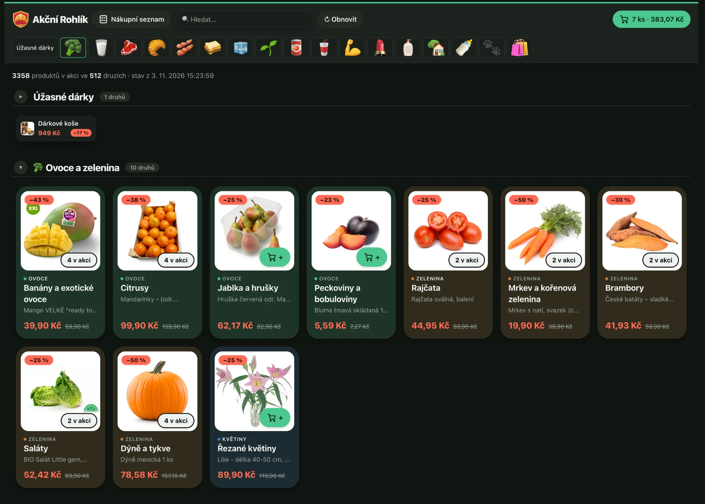

# ⚡ Akční Rohlík



Osobní appka nad rohlik.cz pro rychlejší nakupování akčních produktů. Místo nekonečného seznamu
ukáže **jednu kartu na druh potraviny** (Káva, Příkrmy, Sprchové gely, Jogurty…) s nejvíce zlevněným
reprezentantem. Klik otevře „složku“ (overlay jako na iPhonu) se všemi akčními produkty daného druhu –
s obrázkem, akční cenou, původní cenou, slevou a tlačítkem do košíku.

## Spuštění

```bash
npm install
npm run dev              # API (Hono, :3001) + Vite (:5173)
```

Otevři http://localhost:5173. Druhy jsou seskupené do sekcí (accordion: otevřená je nejvýš jedna, po načtení jsou všechny sbalené, ostatní ukazují náhled 6 druhů z různých podskupin) podle hlavní kategorie Rohlíku, v pořadí Rohlíku. Řazení je „jako v regálu“: karty jdou v pořadí uzlů ze stromu kategorií Rohlíku, seskupené do podskupin s mezititulkem (např. všechny jogurty pohromadě, majonézy vedle tatarek); druhy s víc než 12 produkty se dělí o úroveň hlouběji, pokud to stihnou (časový rozpočet 4 s na kategorii kvůli limitu funkce). Produkty ve složce jdou podle názvu bez gramáže a jednotkové ceny, sleva je jen štítek. Lišta nahoře skáče na kategorii. Akce se stahují po hlavních kategoriích (karty naskakují postupně,
celé první načtení ~30–60 s) a cachují se na 6 hodin do `data/` (v gitu ignorováno).
Tlačítko „Obnovit“ vynutí nové stažení.

## Nákupní seznam

Tlačítko „Nákupní seznam“ (nebo `#seznam` v URL) přepne na textové pole, kam vložíš nákupní seznam. Každá položka
(řádek, nebo části oddělené čárkou / „ a “; odrážky a „2x“/„3 ks“ se odstraní, počet kusů se pamatuje) se napáruje
**jen na produkty v akci**, které už appka má – bez dalších požadavků na Rohlík (`src/listMatch.ts`):

- bez diakritiky a s hrubým českým „stemmingem“ (*Sulanky* = *Šulánky*, *Cukety* = *Cuketa*, *Baterie aaa* najde *Varta … AAA baterie*),
- vyhrává produkt, kde je slovo „hlavou“ názvu (*Rajčata oválná*, *Bramborové šulánky*) nebo sedí na druh z Rohlíku;
  příchutě (*čokoláda s pomerančem*, *pomerančová limonáda*) jsou jen „možná“,
- víceznačná slova (vyskytují se ve ≥3 hlavních kategoriích, např. *pomeranč*) se řídí sousedy na stejném řádku:
  u „pomeranče, mandarinky“ najdou mandarinky ovoce, takže Mirinda Pomeranč se pro pomeranče nabídne jen jako „možná“
  a položka je „v akci není“ s odkazem na hledání na rohlik.cz.

Kliknutím na „Použít tenhle“ se volba pro danou položku zapamatuje (v `localStorage`, stejně jako text seznamu).
„Přidat do košíku vše nalezené“ přidá nejlepší shody postupně (s počtem kusů ze seznamu).

## Proměnné prostředí (`.env`, necommituj)

| Proměnná | Význam |
| --- | --- |
| `APP_PASSWORD` | volitelné; když je nastavené, `/api/*` vyžaduje HTTP Basic s tímto heslem |

## Košík a přenos do Rohlíku

Appka se k účtu na rohlik.cz **nepřihlašuje** (funguje i přihlášení přes Facebook). Tlačítko u produktu ho přidá do
lokálního košíku (`localStorage`, `src/cart.ts`), který je vidět v horní liště; po kliknutí se otevře okno s úpravou množství.

Do skutečného košíku ho přenese **bookmarklet** (`src/bookmarklet.ts`):

1. V okně košíku přetáhni „Do košíku Rohlíku“ do lišty záložek (jednou).
2. Na rohlik.cz (přihlášený) klikni na tu záložku a povol vyskakovací okno.
3. Bookmarklet otevře appku s `#export`, ta mu přes `postMessage` pošle košík a okno zavře. Pak bookmarklet na rohlik.cz
   zavolá stejný endpoint jako web (`/services/frontend-service/v2/cart`) a doplní jen chybějící kusy – opakované spuštění nic nezdvojí.

Session Rohlíku zůstává jen v prohlížeči, backend o ní nic neví. Bookmarklet má adresu appky zapečenou z místa, kde ho uložíš
(`location.origin`), takže ho ulož z nasazené verze, ne z `localhost`.

## Jak to funguje

- `server/app.ts` – jediná Hono app (`/api/deals`, `/api/deals/part/:id`) + místo pro `APP_PASSWORD`. Lokálně ji servíruje `server/dev.ts`, na Vercelu `api/index.ts`.
- `server/cache.ts` – adaptér cache (lokálně soubory v `data/`).
- `server/rohlik.ts` – klient neoficiálního REST API webu rohlik.cz (stejné endpointy jako web:
  `/api/v1/categories/sales/...`, `/api/v1/products/card`, `/services/frontend-service/v2/cart` – ten volá jen bookmarklet).
  Seznam akcí je veřejný.
- `server/deals.ts` – po hlavních kategoriích (každá samostatný krátký požadavek) projde strom kategorií do 3. úrovně (kategorie → podkategorie → druh),
  každý produkt zařadí do nejhlubší kategorie, kde je v akci. „Druh“ je tedy kategorie z Rohlíku
  (např. *Káva*, *Prací gely*), ne vlastní klasifikace – občas je hrubší (např. *Příkrmy*)
  nebo obecnější (*Bílá* pod *Víno*). Zobrazuje se i nadřazená kategorie.
- `src/` – React + Tailwind frontend, Vite proxuje `/api` na backend.

## Budoucí nasazení na Vercel

Architektura je na to připravená (`api/index.ts` + `vercel.json` s rewrite `/api/(.*)`, funkce bez stavu,
limit ~10 s na funkci splňuje stahování po jedné hlavní kategorii). Před nasazením je potřeba:

1. Napsat sdílený adaptér cache (Vercel Blob / KV) místo `MemoryCache` v `server/cache.ts` – paměť funkce se mezi instancemi nesdílí.
2. Nastavit `APP_PASSWORD` (nebo zapnout Vercel Authentication) v nastavení projektu `fast-rohlik`. Repo nech private.
3. Nasazení zatím nebylo zkoušeno.

## Upozornění

API není oficiální a může se kdykoli změnit. Podmínky Rohlíku povolují využití jen k lepšímu nakupování
na rohlik.cz; jiné použití vyžaduje jejich písemný souhlas. Používej appku jen osobně na vlastním účtu,
nešiř ji a nezatěžuj Rohlík (backend omezuje souběh a cachuje).
